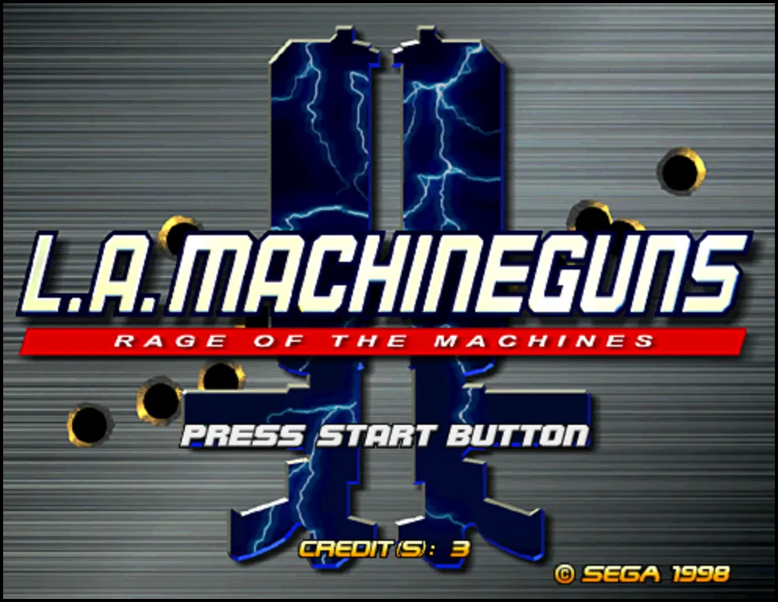

# L.A. Machineguns PC VR — Supermodel with OpenXR

<p align="center"></p>

Play Sega's 1998 light-gun arcade game **L.A. Machineguns: Rage of the Machines** in VR. This is a fork of the [Supermodel](https://github.com/trzy/Supermodel) Sega Model 3 emulator with an OpenXR mode. Your PC runs the emulator and streams it to the headset.

Developed and tested on a Meta Quest 3 streamed with **Virtual Desktop** (VDXR runtime). Meta Quest Link and SteamVR are standard OpenXR runtimes and should work too.

> **No game files are included.** You need your own `lamachin.zip` ROM set, dumped from hardware you own. Please don't open issues or pull requests asking for ROMs.

## Quick start (Windows)

1. Download `SupermodelVR-windows.zip` from the [Releases](../../releases) page, or from the artifacts of the latest successful [Actions](../../actions) run, and unzip it.
2. Put `lamachin.zip` in the `ROMs` folder.
3. Make your streaming app the active OpenXR runtime:
   - **Virtual Desktop:** in the Streamer app on the PC, set *OpenXR Runtime* to **VDXR**.
   - **Quest Link:** in the Meta Quest Link app, go to Settings › General › OpenXR Runtime.
   - **SteamVR:** in SteamVR's settings, go to OpenXR.
4. Connect the headset, then double-click **`Play LA Machineguns VR.bat`**. The game waits until the headset is in use, so you can start it from the PC first.

### Controls

| Controller | Action |
|---|---|
| Trigger (either hand) | Fire. The hand you fire with becomes the gun. |
| A or Y | Start |
| B or X | Coin |
| Right stick click | Re-centre the view |
| Left grip + left stick click | Operator (test) menu |
| Esc (PC keyboard) | Quit |

For the smoothest play in Virtual Desktop, set Synchronous Spacewarp to **Disabled** and the frame rate to 72, 90 or 120 Hz. All VR settings are in `Config/Supermodel.ini`, documented in [`Docs/PCVR.txt`](Docs/PCVR.txt).

## Building

**Windows (what the CI does):** in MSYS2 with `mingw-w64-x86_64-gcc`, `SDL2` and `SDL2_net` installed, run:

```
make -f Makefiles/Makefile.Win32 release
```

Then add `openxr_loader.dll` from the [Khronos OpenXR SDK](https://github.com/KhronosGroup/OpenXR-SDK-Source/releases). See [`.github/workflows/pcvr-windows.yml`](.github/workflows/pcvr-windows.yml) for the full packaging. Every push builds a zip, and pushing a `v*` tag publishes a release.

**Linux:** run `make -f Makefiles/Makefile.UNIX NET_BOARD=0`. This builds the same VR code on GLX and is handy for testing with [Monado](https://monado.freedesktop.org/). The OpenXR headers are vendored in `Src/Pkgs/openxr`, and the loader is loaded at run time, so non-VR use doesn't need it.

Start it with `supermodel <rom.zip> -vr -window -res=992,768 -no-wide-screen`.

## How it works

The VR code is small and mostly self-contained:

| Where | What |
|---|---|
| `Src/OSD/VR/DesktopXR.*` | OpenXR session, swapchains, controller input, `xrWaitFrame` on its own thread, the 2D layers drawn into each eye (room-fixed or head-locked), backdrop |
| `Src/Graphics/New3D/VRHooks.h` | Interface between the New3D renderer and the VR layer |
| `Src/Graphics/New3D/New3D.cpp`, `R3DShader.*` | The scene is built once per frame. It is drawn flat (for the PC window and the light-gun reads), then once per eye with the eye's view and field of view. Culling is off, so the world beyond the 4:3 frame is drawn. |
| `Src/Model3/Model3.*` | Non-blocking emulator frames (post / poll / collect), so the headset never waits for the PowerPC thread |
| `Src/OSD/SDL/Main.cpp` | The VR main loop, controller-to-light-gun mapping, quick boot, hold-until-headset, gun calibration |

Some findings that may help with other Model 3 games:

- **The crosshair has its own viewport.** L.A. Machineguns draws its crosshair in a separate full-screen viewport with a narrower field of view (tan ±0.352 × ±0.268) than the world (±0.649 × ±0.477). In stereo, such viewports are remapped onto the main view's screen, otherwise the crosshair drifts towards the centre while the shots don't.
- **The game doesn't clamp the aim.** It extrapolates past its AIM SET range. With the range set to the middle half of the gun's travel, it aims, and draws its crosshair, a screen-width past each edge. The range lives in EEPROM and is copied to RAM at boot (`0x1234`: Y max, Y min, X max, X min). The VR build writes it there after the boot tests, so no NVRAM has to ship.
- **The game does its own hit detection.** It doesn't use the Real3D line-of-sight registers.

More details and measurements are in [`Docs/PCVR.txt`](Docs/PCVR.txt) and in the commit history.

## Credits and licence

- **Emulator:** [Supermodel](https://github.com/trzy/Supermodel) by Bart Trzynadlowski and the Supermodel Team. The original README is in [`Docs/Supermodel-README.md`](Docs/Supermodel-README.md).
- **OpenXR headers and loader:** The Khronos Group (Apache-2.0).

This project is licensed under the **GNU General Public License v3.0**, like Supermodel. See [`LICENSE`](LICENSE). Any changes you distribute must stay under the GPL, with their source available.

L.A. Machineguns, Model 3 and SEGA are trademarks of SEGA. This project is not affiliated with or endorsed by SEGA.
